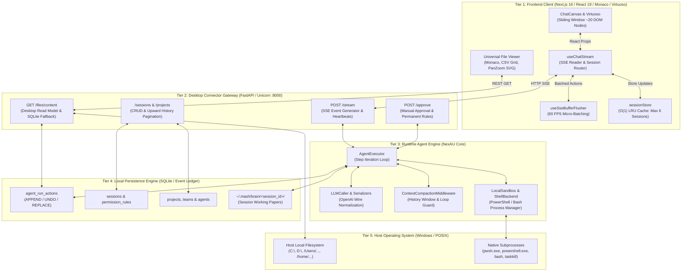
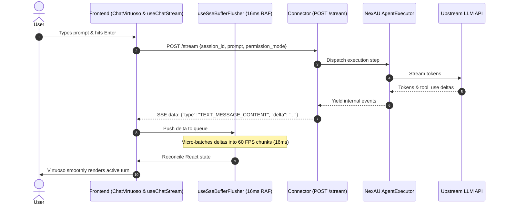
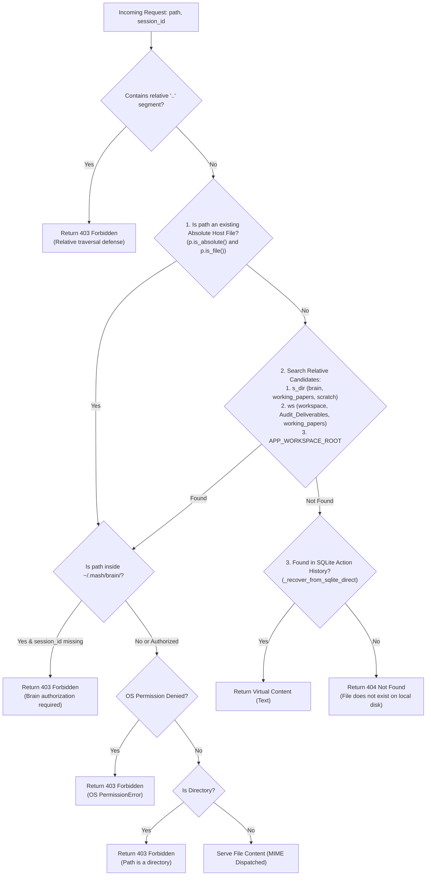

# MASH SYSTEM ARCHITECTURE & CANONICAL AGENT DIRECTIVES

> **CRITICAL DIRECTIVE FOR ALL AI AGENTS, TOOLS, AND CONTRIBUTORS:**
> Mash is a **NATIVE DESKTOP DEVELOPER AGENT** executing locally on the user's personal workstation.
> It is **NOT A MULTI-TENANT WEB SAAS**.
> The entity executing the backend and frontend **IS THE LOCAL HOST OS USER**.
>
> ❌ **DO NOT** apply cloud SaaS chroot jailing or artificial filesystem restrictions.  
> ❌ **DO NOT** treat local absolute paths, external drives, or host file reads as "attacks".  
> ❌ **DO NOT** return `403 Forbidden` for non-existent local files. Missing files are **`404 Not Found`**.  
> 
> Security in Mash lives in **MUTATION AND EXECUTION APPROVAL** (human-in-the-loop consent before modifying files or executing shell commands), **NEVER** in hiding files from the user who owns the machine.

---

## Table of Contents
1. [Core Philosophy & Threat Model: Desktop App vs Cloud SaaS](#1-core-philosophy--threat-model-desktop-app-vs-cloud-saas)
2. [System Topology & Process Architecture](#2-system-topology--process-architecture)
3. [Vertical Subsystems Deep-Dive](#3-vertical-subsystems-deep-dive)
   - [Subsystem 1: Real-Time SSE Chat Streaming & Viewport Virtualization](#subsystem-1-real-time-sse-chat-streaming--viewport-virtualization)
   - [Subsystem 2: Human-in-the-Loop Permissions & Preemptive Steering](#subsystem-2-human-in-the-loop-permissions--preemptive-steering)
   - [Subsystem 3: Universal Artifact Viewer & Desktop Read Model](#subsystem-3-universal-artifact-viewer--desktop-read-model)
   - [Subsystem 4: Multi-Session State, Memory Eviction & History Pagination](#subsystem-4-multi-session-state-memory-eviction--history-pagination)
   - [Subsystem 5: Context Compaction & The Infinite Loop Guard](#subsystem-5-context-compaction--the-infinite-loop-guard)
   - [Subsystem 6: Local Shell Execution & Process Management](#subsystem-6-local-shell-execution--process-management)
   - [Subsystem 7: Model Normalization & Universal Message Protocol (UMP)](#subsystem-7-model-normalization--universal-message-protocol-ump)
   - [Subsystem 8: Workspaces, Projects & Multi-Agent Teams](#subsystem-8-workspaces-projects--multi-agent-teams)
4. [Complete SQLite Database Reference (`~/.mash/database/mash.db`)](#4-complete-sqlite-database-reference-mashdatabasemashdb)
5. [Testing, Benchmarks & Quality Gates](#5-testing-benchmarks--quality-gates)
6. [The 7 Golden Directives for AI Agents](#6-the-7-golden-directives-for-ai-agents)

---

## 1. Core Philosophy & Threat Model: Desktop App vs Cloud SaaS

The primary failure mode of automated AI coding assistants when working on Mash is mistaking its technology stack (FastAPI backend + Next.js React frontend) for a public multi-tenant cloud service. Understanding this distinction is foundational:

```
┌─────────────────────────────────────────────────────────────────────────────┐
│                            CLOUD SAAS THREAT MODEL                          │
│                                                                             │
│   Untrusted Remote User ──(HTTP)──> [Multi-Tenant Server] ──> Shared Disk   │
│   Threat: Tenant A tries to read Tenant B's files or host root (/etc/passwd)│
│   Defense: Chroot jail, strict relative path whitelisting, 403 on traversal │
└─────────────────────────────────────────────────────────────────────────────┘

┌─────────────────────────────────────────────────────────────────────────────┐
│                            MASH DESKTOP THREAT MODEL                        │
│                                                                             │
│   Workstation Owner ──(Localhost)──> [Mash Backend] ──> Local Host Disk     │
│                                           │                                 │
│                                           ▼                                 │
│                                  [LLM Agent Engine]                         │
│                                                                             │
│   Threat: Model hallucination or untrusted repo executing dangerous code    │
│   Defense: Interactive Permission Gate (allow/deny shell commands & writes) │
│   Read Philosophy: User can inspect ANY local file their OS user owns      │
└─────────────────────────────────────────────────────────────────────────────┘
```

### Key Behavioral Invariants:
1. **The Desktop Read Model**:
   - The user frequently asks Mash to view files located in `~/Downloads`, `~/Desktop`, external storage drives (`D:\`, `E:\`, `/Volumes/`), or sibling repositories.
   - Any local file readable by the host operating system user MUST be viewable in Mash's Universal File Viewer via `GET /files/content`.
   - Never artificially restrict reads to the project workspace root.
2. **Missing Files Return 404, Not 403**:
   - Returning `403 Forbidden` for a file that does not exist on disk is an anti-pattern. If a path does not exist, return `404 Not Found`.
   - Only return `403 Forbidden` when the operating system raises `PermissionError` (e.g. attempting to read a protected system file without OS permissions), when attempting to read a directory as a file, or when attempting unauthorized access to another session's private brain storage.
3. **Execution & Mutation Security (Human-in-the-Loop)**:
   - Security in Mash is enforced strictly at the **mutation boundary**:
     - Running shell commands (`run_shell_command`)
     - Writing files (`write_file`, `replace_file_content`)
     - External network fetches (`web_fetch`)
   - Dangerous operations pause the agent loop and prompt the user via an interactive approval modal card.

---

## 2. System Topology & Process Architecture

Mash operates entirely on `localhost`. No data leaves the user's workstation except for external LLM API completions.



### Local Process & Port Bindings:
- **Frontend UI**: Next.js 16 app running on `http://localhost:3000`.
- **Connector API**: FastAPI app running via Uvicorn on `http://127.0.0.1:8000`.
- **Primary Database**: `~/.mash/database/mash.db` (SQLite with WAL mode).
- **Session Artifacts**: `~/.mash/brain/<session_id>/` (working papers, scratchpads, tool outputs).

---

## 3. Vertical Subsystems Deep-Dive

### Subsystem 1: Real-Time SSE Chat Streaming & Viewport Virtualization

#### 1. End-to-End Execution Sequence


#### 2. Complete Wire Protocol Event Catalogue
Every event transmitted over `POST /stream` adheres strictly to the format `data: <JSON>\n\n`. Both the backend (`chat_streamer.py`) and frontend (`services/stream.ts`) normalize the following complete event set:

| SSE Event `type` | Payload Keys | Purpose / Frontend Action |
| :--- | :--- | :--- |
| **`RUN_STARTED`** | `run_id`, `session_id` | Initializes new execution turn in UI; attaches abort controller. |
| **`TEXT_MESSAGE_START`** | `run_id`, `message_id` | Signals assistant text generation is beginning. |
| **`TEXT_MESSAGE_CONTENT`** / **`TEXT_MESSAGE_CHUNK`** | `run_id`, `delta` | Assistant token delta; batched by `useSseBufferFlusher`. |
| **`THINKING_START`** | `run_id` | Opens collapsible reasoning block in UI. |
| **`THINKING_CONTENT`** / **`THINKING_TEXT_MESSAGE_CONTENT`** / **`REASONING_MESSAGE_CONTENT`** | `run_id`, `delta` | Reasoning/Chain-of-Thought token delta. |
| **`THINKING_TEXT_MESSAGE_END`** / **`REASONING_MESSAGE_END`** | `run_id` | Closes reasoning block and records duration. |
| **`TOOL_CALL_START`** | `run_id`, `tool_call_id`, `tool_name`, `parameters` | Mounts active tool card in execution timeline. |
| **`TOOL_CALL_ARGS`** | `run_id`, `tool_call_id`, `delta` | Streams tool JSON argument chunks. |
| **`TOOL_CALL_END`** | `run_id`, `tool_call_id` | Finalizes tool argument streaming before execution. |
| **`TOOL_CALL_RESULT`** | `run_id`, `tool_call_id`, `tool_name`, `content`, `status`, `duration_seconds` | Closes tool card with stdout/stderr, duration, and status badge. |
| **`TOOL_CALL_PENDING_APPROVAL`**| `tool_call_id`, `run_id`, `tool_name`, `prompt`, `parameters` | Displays interactive modal card for user approval. |
| **`COMPACTION_STARTED`** | `trigger_reason` | Displays transient context compaction banner in chat. |
| **`COMPACTION_FINISHED`** | `tokens_saved`, `summary` | Replaces compaction banner with token savings badge. |
| **`RETRY`** | `attempt` | Signals upstream provider retry; resets uncommitted stream buffer. |
| **`RUN_FINISHED`** | `run_id`, `session_id`, `result` | Finalizes turn; clears streaming spinners. |
| **`RUN_ERROR`** / **`TRANSPORT_ERROR`** | `run_id`, `message` | Normalizes error into clean notice; triggers retry UI. |
| **`: heartbeat`** | *(Comment line)* | Sent every 15.0s during idle periods to prevent proxy timeouts. |

#### 3. Graceful Empty-Response Degradation
Under heavy load, upstream proxy drops, or aggressive moderation filtering, an LLM may terminate without emitting tokens or tool calls. NexAU yields a `RUN_ERROR` with `"No response content or tool calls"`.
[`connector/app/services/chat_streamer.py:169-193`](file:///c:/Users/rama/Downloads/Mash/connector/app/services/chat_streamer.py#L169-L193) intercepts this error, shields the user from raw stack traces, and converts it into a clean, recoverable message:
```python
if "No response content or tool calls" in err_msg_s or "never aggregated with any content" in err_msg_s:
    notice = "The model returned an empty response. Please rephrase your query or provide more context."
    yield f"data: {json.dumps({'type': 'RUN_STARTED', 'run_id': run_id, 'session_id': session_id})}\n\n"
    yield f"data: {json.dumps({'type': 'TEXT_MESSAGE_CONTENT', 'delta': notice, 'run_id': run_id})}\n\n"
    yield f"data: {json.dumps({'type': 'RUN_FINISHED', 'run_id': run_id, 'session_id': session_id, 'result': notice})}\n\n"
```

#### 4. Virtualized Viewport Architecture
- Implemented in [`frontend/src/features/chat/components/ChatVirtuoso.tsx`](file:///c:/Users/rama/Downloads/Mash/frontend/src/features/chat/components/ChatVirtuoso.tsx).
- **Strict DOM Ceiling**: Only ~15 to 20 turn rows remain mounted in the DOM at any given moment, even if a session contains 50,000 steps.
- **Scroll Pinning**:
  ```tsx
  followOutput={(isAtBottom) => (isAtBottom && isPinnedToBottom ? 'auto' : false)}
  ```
  Auto-scrolling strictly respects user intent: if the user scrolls up to inspect previous code, auto-scrolling is paused until they scroll back to the bottom.

#### 5. Background Streaming Isolation
If Session A is streaming and the user clicks Session B in the sidebar:
- `useChatStream.ts` switches the active session view.
- Incoming SSE chunks for Session A bypass React state entirely and write directly into `sessionStore.get('Session A')`.
- Zero CPU/GPU cycles are spent updating the virtual DOM for background tabs. When the user returns to Session A, the complete assembled state is rendered instantly.

---

### Subsystem 2: Human-in-the-Loop Permissions & Preemptive Steering

#### 1. The 3 Permission Modes
Defined in [`connector/app/services/chat_permissions.py`](file:///c:/Users/rama/Downloads/Mash/connector/app/services/chat_permissions.py):
1. **`"turbo"`**: All tools execute immediately without interactive approval (`allow: ["**"]`).
2. **`"review"`**: Every tool call pauses the agent and requires explicit user consent (`allow: []`).
3. **`"default"`**: Balanced desktop developer mode:
   - **Sensitive Tools** require confirmation:
     - `run_shell_command` (subprocesses, terminal scripts)
     - `write_file` (creating or overwriting files)
     - `replace_file_content` (modifying code blocks)
     - `web_fetch` (outbound network requests)
   - **Read-Only Tools** run automatically:
     - `read_file`, `view_file`, `glob_tool`, `search_file_content`

#### 2. Preemptive Steering Veto
When an agent proposes a dangerous tool call and pauses for user confirmation, the user might notice the agent is on the wrong track and simply send a new prompt (e.g., *"Wait, don't delete that, do X instead"*).
- The system recognizes this as an **immediate preemptive veto**.
- [`connector/app/services/chat_permissions.py:79`](file:///c:/Users/rama/Downloads/Mash/connector/app/services/chat_permissions.py#L79) invokes `handle_preemptive_steer`:
  1. Auto-denies all pending tool calls with feedback: `"Superseded by user mid-flight steering"`.
  2. Calls `server.handle_stop_request(force=True)` to terminate the pending iteration.
  3. Frontend (`streamRetryManager.ts:51`) immediately marks pending approval tools as `status: 'denied', decision: 'deny'`.
  4. Wraps the new user prompt inside `<USER_STEERING>` protocol envelopes.
  5. Delivers the prompt to the active session inbox. The dangerous tool **never executes**.

---

### Subsystem 3: Universal Artifact Viewer & Desktop Read Model

#### 1. The 4-Tier Path Resolution Hierarchy
When the frontend requests file content via `GET /files/content?path=<path>&session_id=<sid>`, [`connector/app/routers/artifacts.py`](file:///c:/Users/rama/Downloads/Mash/connector/app/routers/artifacts.py) resolves the target through sequential rungs:



#### 2. Relative Traversal vs Absolute Host Access
- **Relative Path Traversal Defense**: Passing relative paths containing `..` (e.g. `path="../../foo.txt"`) is rejected with `403 Invalid path traversal detected` to prevent ambiguous directory escaping.
- **Absolute Host Paths**: Fully supported! The host OS user can open any absolute path (`C:\Users\rama\Desktop\notes.txt`, `D:\data\sample.csv`, `/home/user/paper.pdf`). Absolute paths bypass relative candidate searching and are directly served.

#### 3. Content Dispatch & MIME Handling
- **PDF Documents** (`.pdf`): Served via `FileResponse(media_type="application/pdf", content_disposition_type="inline")`.
- **Images & Vector Graphics** (`.png`, `.jpg`, `.svg`, `.webp`, `.gif`): Served inline; frontend renders inside interactive PanZoom viewport.
- **Spreadsheets** (`.xlsx`, `.xls`, `.ods`): Served as JSON descriptor (`{"type": "excel", "filename": ...}`); client-side SheetJS parses raw bytes into interactive data grid.
- **Text & Source Code** (`.ts`, `.py`, `.rs`, `.md`, `.json`, `.csv`, etc.):
  - Safe 10 MB preview cap: Files larger than 10,000,000 bytes are truncated at the nearest newline with `is_truncated: true`.
  - Line ending normalization: Normalizes mixed CRLF (`\r\r\n` and `\r\n`) to clean `\n`.
  - Frontend renders in Monaco Editor with syntax highlighting and diff viewing.
- **Binary & Archives** (`.zip`, `.tar.gz`, `.exe`, `.bin`): Served as attachment download.
- **Virtual SQLite Fallback**: If an agent deliverable was deleted from disk or generated ephemerally, `_recover_from_sqlite_direct` scans `agent_run_actions` and reconstructs the content from tool call arguments.

---

### Subsystem 4: Multi-Session State, Memory Eviction & History Pagination

#### 1. Client-Side LRU Memory Eviction
Implemented in [`frontend/src/features/chat/state/sessionStore.ts`](file:///c:/Users/rama/Downloads/Mash/frontend/src/features/chat/state/sessionStore.ts):
- Low-memory desktop workstations cannot hold hundreds of session DOM trees and token buffers in JavaScript heap.
- `sessionStore` maintains an $O(1)$ LRU Cache enforcing **`MAX_CACHED_SESSIONS = 6`**.
- When a 7th session is accessed:
  ```ts
  if (sessionStore.size >= MAX_CACHED_SESSIONS) {
    for (const [cachedSid, cachedState] of sessionStore.entries()) {
      if (
        !cachedState.isStreaming &&
        cachedSid !== currentViewingSessionId &&
        cachedSid !== sid &&
        (!cachedState.queuedMessages || cachedState.queuedMessages.length === 0)
      ) {
        sessionStore.delete(cachedSid);
        break;
      }
    }
  }
  ```
- **The 3 Invariable Eviction Guards**:
  1. The currently viewed session is NEVER evicted.
  2. Actively streaming sessions are NEVER evicted.
  3. Sessions with pending queued prompts are NEVER evicted.

#### 2. History Pagination (Smooth Upward Scrolling)
Implemented in [`frontend/src/features/chat/hooks/useSessionHistory.ts`](file:///c:/Users/rama/Downloads/Mash/frontend/src/features/chat/hooks/useSessionHistory.ts):
- Initial session mount fetches only the latest **100 turns** (< 3 MB RAM).
- When the user scrolls to the top, `loadEarlierTurns` fetches the next chunk in smooth increments of **`PAGE_SIZE = 40`**.
- **Atomic Index Reconciliation**: Passes the exact number of prepended turns to Virtuoso's `firstItemIndex`. The scroll container does not jump or flicker.

#### 3. Session Cleanup & Brain Pruning
When a session is deleted via `DELETE /sessions/{id}`:
- Session metadata is deleted from SQLite `sessions` table.
- Nanosecond distributed locks in `agent_locks` are released.
- [`safe_rmtree_session_brain`](file:///c:/Users/rama/Downloads/Mash/connector/app/paths.py) cleanly deletes both the active brain directory `~/.mash/brain/<sid>/` and any legacy working directories `~/.nexau/brain/<sid>/`.

---

### Subsystem 5: Context Compaction & The Infinite Loop Guard

#### 1. The DeepSeek Agent Harness #8088 Root Cause
In standard agent harness implementations (such as DeepSeek Agent Harness `dsh`), context compaction was triggered by measuring total tokens:
$$\text{Total Tokens} = \text{System Prompt} + \text{Tool Schemas} + \text{Message History}$$
When an agent was loaded with large system prompts and 30+ complex tool definitions, the static tokens alone exceeded the compaction threshold:
$$\text{Static Tokens} \ge \text{Threshold}$$
**The Fatal Flaw**: Even when message history was compacted to 0 messages, the next turn still measured $\text{Total Tokens} \ge \text{Threshold}$, immediately triggering compaction again. The agent entered an infinite compaction loop, consuming tokens and freezing execution.

#### 2. The Mash Guard & Compaction Flow
[`NexAU/nexau/archs/main_sub/execution/middleware/context_compaction/`](file:///c:/Users/rama/Downloads/Mash/NexAU/nexau/archs/main_sub/execution/middleware/context_compaction/):
1. **Shrinkable History Evaluation**: The compaction threshold is evaluated strictly against the **shrinkable message history**, excluding fixed system instructions and tool definitions.
2. **Trigger Modes**:
   - `regular`: Evaluated before model calls when message history exceeds 75% of allowed budget.
   - `emergency`: Triggered immediately if an LLM returns a context overflow error (e.g. `"context_length_exceeded"`, `"exceeds the available context size"`).
3. **The Replacement Barrier**:
   - The compactor summarizes older turns, archives the full raw text via `HistoryArchiveWriter`, and appends an action of type `REPLACE` to `agent_run_actions` with `ReplaceExtra(reason="compact_auto")`.
   - When `agent_run_action_service.py:load_messages` scans actions backwards (`DESC`), it **stops immediately** upon reaching the `REPLACE` barrier. Historical compacted actions are never re-evaluated.

---

### Subsystem 6: Local Shell Execution & Process Management

#### 1. Native Subprocess Execution Model
[`NexAU/nexau/archs/sandbox/local_sandbox.py`](file:///c:/Users/rama/Downloads/Mash/NexAU/nexau/archs/sandbox/local_sandbox.py) executes commands on the host machine using `subprocess.Popen`:
- Background processes are registered per-session in `_registry_by_session[session_id]`.
- Commands execute with target directory working scope (`cwd`).

#### 2. Cross-Platform Shell Resolution
[`NexAU/nexau/archs/platform/shell_backend.py`](file:///c:/Users/rama/Downloads/Mash/NexAU/nexau/archs/platform/shell_backend.py):
- **Windows Resolution Order**:
  1. `pwsh.exe` (PowerShell Core 7+, if installed)
  2. `powershell.exe` (Windows PowerShell 5.1, builtin)
  3. `cmd.exe` (Command Prompt fallback)
  4. Git Bash (`bash.exe`) is an explicit opt-in for POSIX-specific scripts.
- **POSIX Resolution Order**: `/bin/bash` -> `/bin/sh`.

#### 3. Console Window Suppression & Clean Termination
- **Zero Flickering Windows**: GUI subprocesses on Windows are launched with `CREATE_NO_WINDOW` and `CREATE_NEW_PROCESS_GROUP`. Terminal tools (rg, git, python) never flash console windows over the user's desktop.
- **Process Tree Kill**:
  - Windows: Executed via `taskkill.exe /PID <pid> /T /F` to guarantee child processes spawned by batch scripts or PowerShell are cleanly killed.
  - POSIX: Executed via `os.killpg(os.getpgid(pid), signal.SIGKILL)`.

---

### Subsystem 7: Model Normalization & Universal Message Protocol (UMP)

#### 1. The `ModelResponse` Dataclass & Reasoning Alias
[`NexAU/nexau/archs/main_sub/execution/model_response.py`](file:///c:/Users/rama/Downloads/Mash/NexAU/nexau/archs/main_sub/execution/model_response.py):
Different model providers and tool serializers alternate between calling thinking content `reasoning` or `reasoning_content`. Mash defines a universal property alias to permanently prevent `AttributeError`:
```python
@dataclass
class ModelResponse:
    content: str | None = None
    reasoning_content: str | None = None
    tool_calls: list[ToolCall] = field(default_factory=list)

    @property
    def reasoning(self) -> str | None:
        return self.reasoning_content

    @reasoning.setter
    def reasoning(self, value: str | None) -> None:
        self.reasoning_content = value
```

#### 2. Small Model XML Tool Call Recovery
Small reasoning models (e.g. DeepSeek-R1-Distill-1.7B, Qwen-2.5-Coder-7B) often emit tool calls formatted as raw XML inside their thinking blocks rather than structured OpenAI function call JSON payloads.
[`NexAU/nexau/archs/main_sub/execution/response_parser.py`](file:///c:/Users/rama/Downloads/Mash/NexAU/nexau/archs/main_sub/execution/response_parser.py):
- Recovers XML blocks matching `<tool_use><tool_name>...</tool_name><arg_name>...</arg_name></tool_use>`.
- Parameter sanitization: Strips hallucinated closing tags (e.g. `</arg_value>`) that small models append to string parameters.

#### 3. Provider Contract Repair at DB Read Boundary
[`NexAU/nexau/archs/session/agent_run_action_service.py`](file:///c:/Users/rama/Downloads/Mash/NexAU/nexau/archs/session/agent_run_action_service.py):
- **`_is_reasoning_only_assistant`**: Drops assistant turns that contain reasoning blocks but zero text or tool calls. Feeding these to Google Gemini or OpenAI causes immediate `400 Bad Request` (`"parts must not be empty"`).
- **`_ensure_tool_use_paired`**: Anthropic Claude API rejects any message payload where a `tool_use` is not immediately paired with a `tool_result`. If an agent run crashes or the process is killed midway, NexAU injects a synthetic error tool result to repair the pairing before transmitting to the provider.

---

### Subsystem 8: Workspaces, Projects & Multi-Agent Teams

- **Projects**: Local folders registered in the `projects` table. Each session binds to a project workspace via `resolve_session_workspace`.
- **Multi-Agent Teams**: Defined by `teams`, `team_members`, `team_messages`, `team_tasks`, and `team_task_locks` tables:
  - `TeamModel`: Scopes team leader and candidate agent configurations.
  - `TeamMemberModel`: Scopes individual agent roles (`idle`, `running`, `stopped`) with isolated sub-sessions (`member_session_id`).
  - `TeamMessageModel`: Tracks inter-agent communications and deliveries.
  - `TeamTaskModel`: Work item queue with task dependencies, priorities, and assigned agents.
  - `TeamTaskLockModel`: Nanosecond task claims preventing multiple agents from picking up the same item.

---

## 4. Complete SQLite Database Reference (`~/.mash/database/mash.db`)

Mash uses SQLite in WAL mode. The database contains 11 core tables managed by SQLAlchemy, SQLModel, and Alembic:

### 1. Table: `sessions`
```sql
CREATE TABLE sessions (
    user_id VARCHAR NOT NULL, 
    session_id VARCHAR NOT NULL, 
    created_at DATETIME NOT NULL, 
    updated_at DATETIME NOT NULL, 
    context JSON,                     -- Runtime context: cwd, username, git branch
    storage JSON,                     -- GlobalStorage cross-agent data sharing
    sandbox_state JSON,               -- Sandbox state for resumption
    root_agent_id VARCHAR,             -- Main agent identifier
    pending_tool_calls JSON,           -- Dict of tool calls awaiting user approval
    PRIMARY KEY (user_id, session_id)
);
```

### 2. Table: `agent_run_actions`
```sql
CREATE TABLE agent_run_actions (
    action_id VARCHAR NOT NULL PRIMARY KEY, 
    user_id VARCHAR NOT NULL, 
    session_id VARCHAR NOT NULL, 
    agent_id VARCHAR NOT NULL, 
    run_id VARCHAR NOT NULL, 
    root_run_id VARCHAR NOT NULL, 
    parent_run_id VARCHAR, 
    agent_name VARCHAR NOT NULL, 
    created_at DATETIME NOT NULL, 
    created_at_ns INTEGER NOT NULL,   -- Nanosecond timestamp for strict chronological sorting
    action_type VARCHAR NOT NULL,      -- 'append' | 'undo' | 'replace' | 'run_start' | 'run_end'
    append_messages JSON,              -- Messages added in this step
    replace_messages JSON,             -- Messages replacing state (used by compaction)
    undo_before_run_id VARCHAR,        -- Target run_id reverted by undo
    idempotency_key VARCHAR UNIQUE, 
    extra JSON                         -- Metadata (e.g. ReplaceExtra reason="compact_auto")
);
-- High-performance query indexes
CREATE INDEX ix_agent_run_actions_session_id ON agent_run_actions (session_id);
CREATE INDEX ix_agent_run_actions_created_at_ns ON agent_run_actions (created_at_ns);
CREATE INDEX idx_agent_run_actions_created_at_ns ON agent_run_actions (user_id, session_id, agent_id, created_at_ns);
CREATE INDEX idx_agent_run_actions_action_type_created_at_ns ON agent_run_actions (user_id, session_id, agent_id, action_type, created_at_ns);
CREATE INDEX ix_agent_run_actions_action_type ON agent_run_actions (action_type);
CREATE INDEX ix_agent_run_actions_run_id ON agent_run_actions (run_id);
```

### 3. Table: `permission_rules`
```sql
CREATE TABLE permission_rules (
    user_id VARCHAR NOT NULL, 
    session_id VARCHAR NOT NULL, 
    tool_name VARCHAR NOT NULL, 
    rule_content VARCHAR NOT NULL,     -- Wildcard pattern or command prefix (e.g. '**')
    behavior VARCHAR NOT NULL,         -- 'allow' | 'deny'
    source VARCHAR NOT NULL,           -- 'config' | 'user'
    created_at DATETIME NOT NULL, 
    PRIMARY KEY (user_id, session_id, tool_name, rule_content, behavior)
);
```

### 4. Table: `projects`
```sql
CREATE TABLE projects (
    id VARCHAR NOT NULL PRIMARY KEY, 
    user_id VARCHAR NOT NULL, 
    name VARCHAR NOT NULL, 
    local_folder_path VARCHAR NOT NULL, 
    created_at DATETIME NOT NULL, 
    updated_at DATETIME NOT NULL
);
```

### 5. Table: `agents`
```sql
CREATE TABLE agents (
    user_id VARCHAR NOT NULL, 
    session_id VARCHAR NOT NULL, 
    agent_id VARCHAR NOT NULL, 
    agent_name VARCHAR NOT NULL, 
    created_at DATETIME NOT NULL, 
    last_updated DATETIME NOT NULL, 
    PRIMARY KEY (user_id, session_id, agent_id)
);
CREATE INDEX ix_agents_session_id ON agents (session_id);
```

### 6. Table: `agent_locks`
```sql
CREATE TABLE agent_locks (
    session_id VARCHAR NOT NULL, 
    agent_id VARCHAR NOT NULL, 
    user_id VARCHAR, 
    run_id VARCHAR, 
    holder_id VARCHAR NOT NULL, 
    acquired_at_ns INTEGER NOT NULL, 
    expires_at_ns INTEGER NOT NULL, 
    PRIMARY KEY (session_id, agent_id)
);
```

### 7. Table: `teams`
```sql
CREATE TABLE teams (
    user_id VARCHAR NOT NULL, 
    session_id VARCHAR NOT NULL, 
    team_id VARCHAR NOT NULL, 
    leader_agent_id VARCHAR NOT NULL, 
    candidates JSON, 
    max_teammates INTEGER NOT NULL, 
    created_at DATETIME NOT NULL, 
    updated_at DATETIME NOT NULL, 
    PRIMARY KEY (user_id, session_id, team_id)
);
```

### 8. Table: `team_members`
```sql
CREATE TABLE team_members (
    user_id VARCHAR NOT NULL, 
    session_id VARCHAR NOT NULL, 
    team_id VARCHAR NOT NULL, 
    agent_id VARCHAR NOT NULL, 
    member_session_id VARCHAR NOT NULL, 
    role_name VARCHAR NOT NULL, 
    status VARCHAR NOT NULL,           -- 'idle' | 'running' | 'stopped'
    created_at DATETIME NOT NULL, 
    updated_at DATETIME NOT NULL, 
    PRIMARY KEY (user_id, session_id, team_id, agent_id)
);
```

### 9. Table: `team_messages`
```sql
CREATE TABLE team_messages (
    user_id VARCHAR NOT NULL, 
    session_id VARCHAR NOT NULL, 
    team_id VARCHAR NOT NULL, 
    message_id VARCHAR NOT NULL, 
    from_agent_id VARCHAR NOT NULL, 
    to_agent_id VARCHAR, 
    content VARCHAR NOT NULL, 
    message_type VARCHAR NOT NULL, 
    delivered BOOLEAN NOT NULL, 
    delivered_at DATETIME, 
    created_at DATETIME NOT NULL, 
    PRIMARY KEY (user_id, session_id, team_id, message_id)
);
```

### 10. Table: `team_tasks`
```sql
CREATE TABLE team_tasks (
    user_id VARCHAR NOT NULL, 
    session_id VARCHAR NOT NULL, 
    team_id VARCHAR NOT NULL, 
    task_id VARCHAR NOT NULL,          -- e.g. 'T-001'
    title VARCHAR NOT NULL, 
    description VARCHAR NOT NULL, 
    priority INTEGER NOT NULL,         -- 0=normal, 1=high, 2=critical
    status VARCHAR NOT NULL,           -- 'pending' | 'in_progress' | 'completed'
    dependencies JSON,                 -- List of prerequisite task_ids
    assignee_agent_id VARCHAR, 
    result_summary VARCHAR, 
    deliverable_path VARCHAR, 
    created_by VARCHAR NOT NULL, 
    created_at DATETIME NOT NULL, 
    updated_at DATETIME NOT NULL, 
    PRIMARY KEY (user_id, session_id, team_id, task_id)
);
```

### 11. Table: `team_task_locks`
```sql
CREATE TABLE team_task_locks (
    user_id VARCHAR NOT NULL, 
    session_id VARCHAR NOT NULL, 
    team_id VARCHAR NOT NULL, 
    task_id VARCHAR NOT NULL, 
    holder_id VARCHAR NOT NULL, 
    acquired_at_ns INTEGER NOT NULL, 
    expires_at_ns INTEGER NOT NULL, 
    PRIMARY KEY (user_id, session_id, team_id, task_id)
);
```

---

## 5. Testing, Benchmarks & Quality Gates

Every code modification in Mash must be verified against the following standard test suites:

### 1. Frontend Verification Suite
```bash
# 1. Virtuoso sliding window, DOM culling & scroll follow contracts
npm run test:virtuoso --prefix frontend

# 2. 1,000-turn stress benchmark (Mermaids, SVGs, codeblocks, tool traces, LRU eviction)
npm run test:stress --prefix frontend

# 3. 50,000 steps per session stress benchmark (300k steps in RAM, < 50 MB heap)
npm run test:50k --prefix frontend

# 4. Property-based chaos fuzzer (fast-check: zero cross-talk, state invariants)
npm run test:fuzz --prefix frontend

# 5. Pending frontend scenarios (happy path, abort/retry, steering, tool failure)
npm run test:scenarios --prefix frontend
```

### 2. Python Backend & Engine Verification Suite
```bash
# 1. Official Agent Harness Evaluation (20 tests covering wire budget, persistence, isolation)
python -m pytest NexAU/tests/harness_eval/

# 2. Response parser & ModelResponse smoke tests
python -m pytest NexAU/tests/unit/test_response_parser.py NexAU/tests/unit/test_repro_parser_smoke.py

# 3. Streamer graceful degradation (empty response interception)
python -m pytest connector/tests/test_streamer_uploads_runtime.py -k test_empty_llm_response_degrades_gracefully_in_streamer
```

---

## 6. The 7 Golden Directives for AI Agents

1. **Mash is a Desktop Application**:
   You are running on the user's machine. Do not attempt to jail the user from their own filesystem.
2. **Missing Files Return 404**:
   Never return `403 Forbidden` because a file does not exist. A missing file is `404 Not Found`.
3. **Protect Mutations and Executions**:
   Sensitive operations (`run_shell_command`, `write_file`, `replace_file_content`, `web_fetch`) must pass through the interactive permission gate.
4. **Preserve Single Sources of Truth**:
   - Resolve `~/.mash/` paths via `app.paths.get_mash_home()`.
   - Access model thinking via `ModelResponse.reasoning` or `ModelResponse.reasoning_content`.
5. **Evaluate Compaction Against Shrinkable History Only**:
   Never measure context compaction thresholds against immutable system prompts or tool schemas (prevents the DSH #8088 infinite compaction loop).
6. **Maintain Virtuoso Virtualization Invariants**:
   Never force-render thousands of DOM elements. Keep the mounted DOM footprint at ~20 items and paginate history in 40-item chunks.
7. **Leave One Runnable Test Behind**:
   When implementing non-trivial logic, write an assert-based unit test to permanently prevent regressions.
